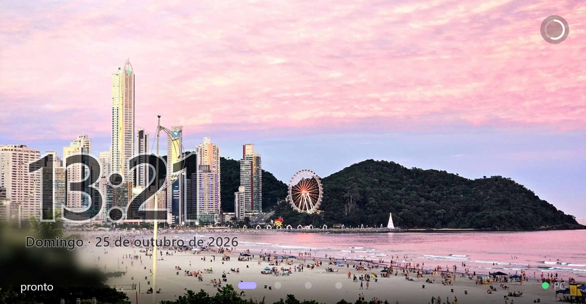
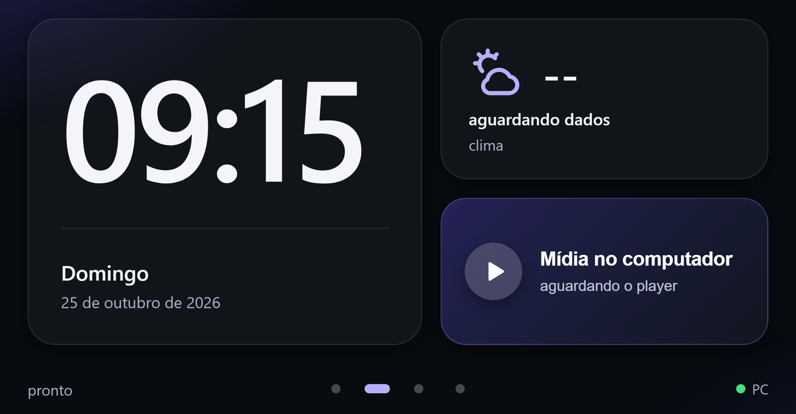
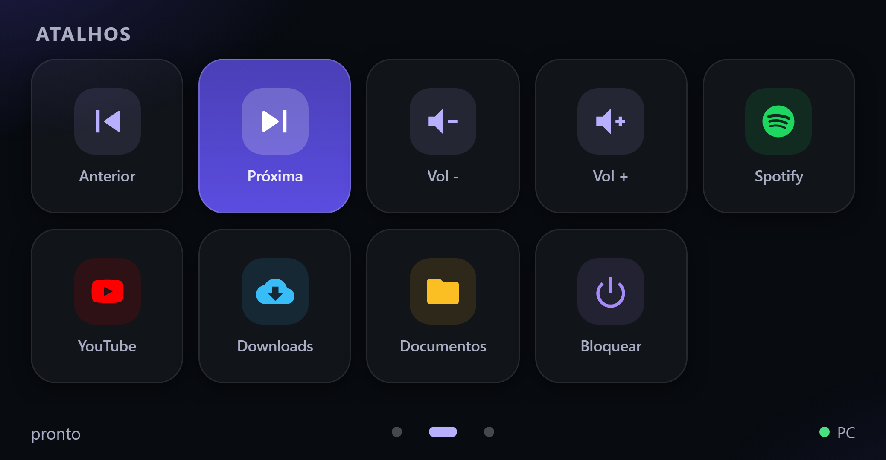
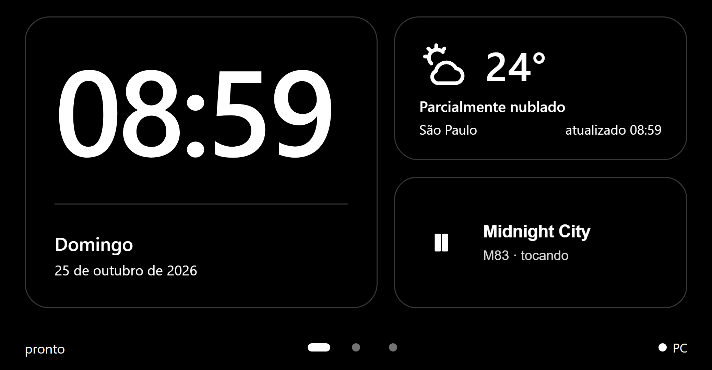

# mcp-display-companion

A small service that runs on your computer and **executes the touches of an
[MCP Display](https://github.com/) wall panel** — a wall panel here means an
Android phone showing a web page (the MCP Display app exposes `show_view`,
`update_view`, `read_events` and `set_display` over MCP at
`http://<phone>:7777/mcp`). The buttons on that page call tools by name, and this
service is what turns those names into real actions on the machine: play/pause,
volume, open a folder, launch an app, run a shortcut. The panel's own guide
(`panel://guide`) is the contract this service follows.

**[Leia em português →](README.pt-BR.md)**







The panel is **data, not instructions**: the service only runs actions that are
declared in `config.json`. A touch carries an action id — never a command line.

## Why this exists

If nobody on the computer is listening, a touch on the panel becomes an event in
a queue that nobody reads: the screen looks alive and nothing happens. An agent
session can read those events for a while — and dies with the session, silently.
This service is the boring part that stays up: it publishes its own screen,
listens, acts, confirms, and says out loud (in its log and on the panel) when it
is not there.

It also survived its own bug report: a version launched from an agent session
worked for a few minutes and then went quiet, because the process tree went with
the session. See [docs/service.md](docs/service.md) — the fix is running it as a
system service, and the reasons why are documented there.

## Requirements

- Python **3.11+**
- An MCP Display panel reachable on the network (`http://<phone-ip>:7777/mcp`)
  and its **token**
- Windows for the full feature set. Media control, cover art and folder
  navigation use Windows APIs (`winrt`, `pywin32`); on macOS/Linux the service
  still runs with the generic host (open folders/URLs/apps/commands) but media
  transport and now-playing metadata are **not** implemented there — the buttons
  exist and report a failed action.

## Quick start

```bash
git clone <url-do-repositório> mcp-display-companion
cd mcp-display-companion

python -m pip install -r requirements-windows.txt   # Windows: media, cover, folders
cp config.example.json config.json                  # edit url, actions, folders

# the token lives OUTSIDE the repo, never in config.json
python -m mcp_display_companion --set-token SEU-TOKEN-AQUI

python -m mcp_display_companion --check        # validates config, shows a summary
python -m mcp_display_companion --print-view   # prints the HTML that will be published
python -m mcp_display_companion               # runs the service (foreground)
```

Then install it as a **system service** so it survives a closed terminal, a
finished agent session and a crash (on Windows it is a logon-triggered task: it
comes back at every logon):

```powershell
# Windows (Task Scheduler; removes the old Startup shortcut, restarts the service)
powershell -ExecutionPolicy Bypass -File scripts\install-service.ps1
```

```bash
# macOS / Linux (launchd agent / systemd --user unit)
./scripts/install-service.sh
```

## Configuring

`config.json` (git-ignored) is the whole product. `config.example.json` is a
working example; `docs/configuration.md` is the reference.

```json
{
  "panel": { "url": "http://192.168.1.50:7777/mcp", "subscribe": true },
  "live": {
    "weather": { "enabled": true, "latitude": -23.55, "longitude": -46.63, "label": "São Paulo" },
    "media":   { "enabled": true, "cover": true }
  },
  "actions": [
    { "id": "pc_midia_play_pause", "label": "Play/Pause", "type": "media",
      "command": "play_pause", "icon": "playpause", "page": 1, "featured": true },
    { "id": "pc_abrir_downloads", "label": "Downloads", "type": "folder",
      "path": "%USERPROFILE%/Downloads", "icon": "download", "color": "#38bdf8" }
  ]
}
```

- **`id`** is the tool name the View calls on a touch. Keep a `pc_` prefix: with
  a mixed screen, a name that also exists on the connection goes to the
  connection, not to you.
- **`page: 1` + `featured: true`** is the big button on the first page (the media
  banner, if the action is `media`); everything else goes to the shortcut grid.
- **Icons** come from `mcp_display_companion/icons.py`; anything else can use
  `icon_svg` with an inline path.
- Adding a button = adding an action. Adding a *new kind* of action = a method in
  `actions.py` (`_run_<type>`) plus a `Host` call.

Action types: `media`, `key`, `volume`, `folder`, `app`, `url`, `command`,
`display`, `rest` — each with its fields in [docs/actions.md](docs/actions.md).

### Presentation page

Drop photos in the **`slides/`** folder that ships with the repo (or point
`slides.folder` anywhere else) and a **page to the left of the clock** appears,
looping through them **full screen** — the photo is the background of the whole
panel, no card and no frame — with a soft crossfade. No image, no page. The service crops each photo to the panel ratio, compresses it and
sends it as a `data:` URL — one image per `interval_s`, prepared in a background
thread so the buttons never wait. Drop a new photo in the folder and it shows up
without restarting anything.

### Rest mode (page 3)

The panel is a wall display: a switch on the **settings page** turns rest mode on
or off. When it is on, after `rest.idle_s` seconds without a touch the screen
turns itself into the same first page in **pure black with white text and no
album cover** — the cheap pixels of an OLED — and the first touch wakes it. The
choice is stored on the PC, so reloading the screen does not forget it. Going
dark also drops the **device brightness to the minimum** and puts it back on the
first touch. Off is the default: the screen simply stays on.

The clock over the photos measures the picture: it picks **white ink on a dark
photo and dark ink on a light one**, adds a thin outline in the opposite tone and
frosts (blurs) only the patch behind the text — so a bright sky or a busy palm
tree does not wash the time out.

## What it does with events

| Event | What the service does |
|---|---|
| `toque` with a known action | runs it, then confirms with `update_view` so the button turns green without reloading |
| `toque` of another connection (`destino_indisponivel`) or unknown name | logs and ignores — the button is not ours |
| `toque` older than `loop.max_event_age_s` | ignores (opening a folder from 20 minutes ago is worse than not opening) |
| `acordou` (screen was off and got touched) | logs only; does not touch brightness again |
| `lacuna: true` (the panel may have dropped events) | does not replay actions; republishes live data |

The cursor is persisted (`cursor.json`), so a restart does not repeat taps.
First read after a cold start only takes the cursor: the panel's queue may hold
touches from hours ago.

## Single instance / Instância única

It refuses to start a second copy (OS file lock): two companions on one panel fight over the View and the screen flickers.

## Security notes

- The token is never in the repository, never in the log and never printed (the
  `--check` summary shows a masked version). See
  [docs/configuration.md#token](docs/configuration.md#token).
- The service knows exactly the actions in `config.json`. It does not evaluate
  anything that comes from the panel, and it asks nobody for confirmation: a
  configured button runs. So **do not configure** power-off, delete or spend
  actions on a panel that other people can touch — the panel is a remote control
  for *your* computer.

## Language

Code, comments, log messages, configuration keys and docs are in English. The
**example screen** — the wording you see on the panel, the labels in
`config.example.json` and the markup ids in the template — is in Portuguese; edit
`mcp_display_companion/templates/painel.html` (and the labels) to translate it. A
Portuguese README lives in [README.pt-BR.md](README.pt-BR.md).

## Development

```bash
python -m pip install pytest
python -m pytest -q          # no network, no Windows APIs: everything is faked
```

Layout:

```
mcp_display_companion/
  __main__.py    CLI: run, --check, --print-view
  config.py      JSON config + secrets, validation, path expansion
  client.py      MCP transport (JSON-RPC over HTTP, SSE subscribe, 404/429)
  events.py      pure decision: which events become actions (tested hard)
  actions.py     the action registry; only configured ids run
  host.py        everything OS-specific (Windows GSMTC/Shell COM, generic fallback)
  live.py        weather (open-meteo) and media metadata, each on its own cadence
  runtime.py     the loop: heartbeat, watchdog, cursor, publish/update, confirm
  view.py        renders templates/painel.html from config
  icons.py       SVG symbols
templates/painel.html   the screen (CSS, clock, gestures, offline badge)
service.py       supervisor: restarts the service and logs why it died
scripts/         installers (Windows Task Scheduler, launchd, systemd --user)
tests/           pytest
```

## Limits

- Windows-only for media metadata/cover and Explorer navigation (the generic
  path opens folders/URLs/apps, and media falls back to media keys).
- Polling fallback is 0.7 s; with `subscribe` the panel pushes and the touch
  reaches the action in ~40 ms.
- The panel limits `update_view`/`set_display` to 10 calls per 10 s; the service
  batches live data and skips unchanged values.
- Weather comes from open-meteo (no key); failure is silent and the card keeps
  the last value.

## License

MIT — see [LICENSE](LICENSE).
