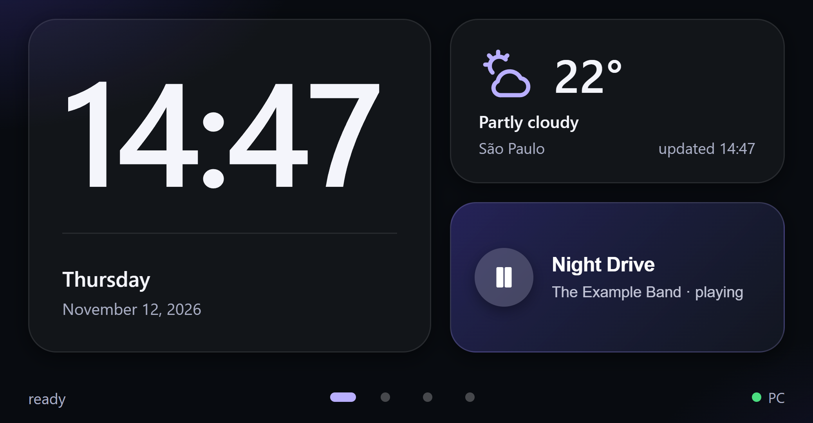
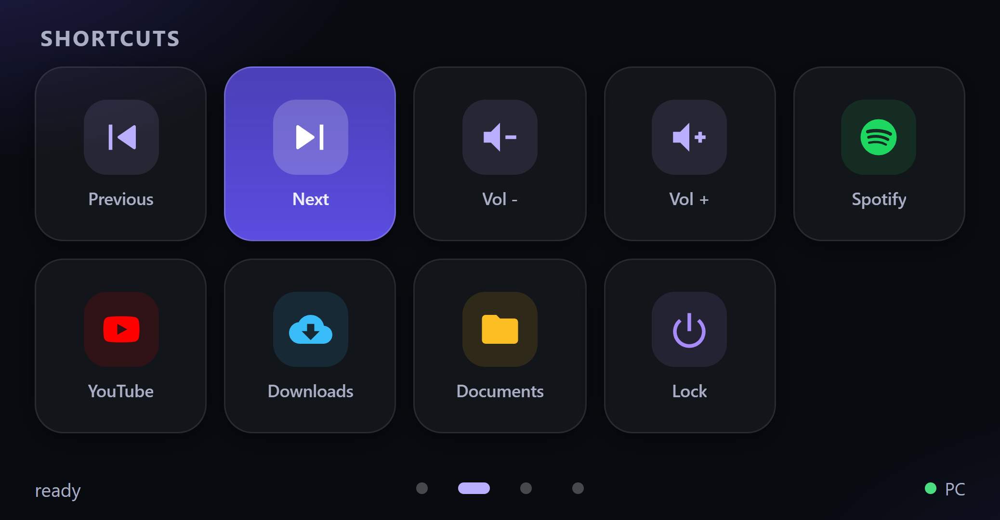
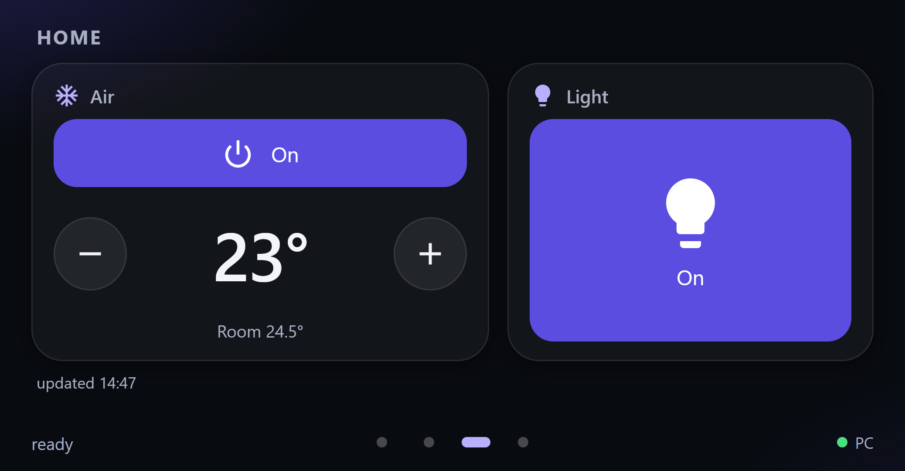
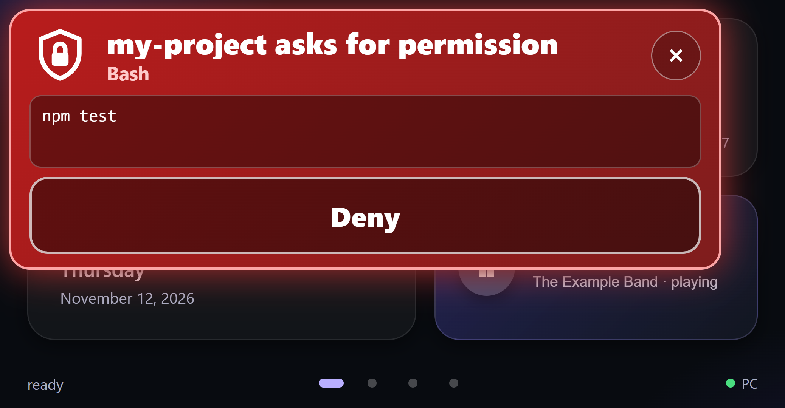

**English** | [Português (Brasil)](README.pt-BR.md)

# MCP Display Companion

**Turn an old Android phone into a wall panel for your AI agent.**

This is a ready-made panel for the [MCP Display](https://okapp.ai/app/mcp-display/en) app ([Google Play](https://play.google.com/store/apps/details?id=br.com.okds.mcpdisplay)). It runs on your computer, puts the screen on the phone and carries out what you touch: media, volume, shortcuts, photos.

[](https://github.com/PatrickCavalcanti/mcp-display-companion/actions/workflows/tests.yml)
[](LICENSE)


<p align="center">
  
</p>
<p align="center">
  
  
  
</p>

## What you get

| Feature | What it does |
|---|---|
| Clock and weather | Big clock and a weather card (open-meteo, no API key). |
| Media and volume | Play/pause, next, previous, volume, and the current track with its cover. Windows only. |
| PC shortcuts | Buttons that open a folder, an app, a web page, run a command or press a key. You declare them in `config.json`. |
| Photo slideshow | A page of full-screen photos from a folder of yours, with a soft crossfade. |
| Rest mode | After a while without a touch, the screen goes black and dim. The first touch wakes it. |
| Upright panel | Hold the phone upright and the same screen rearranges itself into a column. |
| Home page | Air conditioner and light of one room, through [Home Assistant](https://www.home-assistant.io/). Off by default. |
| Claude Code alert | A red banner when a Claude Code session waits for a permission. From the panel you can deny with one tap. |

## Quick start

Already have an AI agent paired with the app (Claude Code, for example)? Ask it to install this project. The app tells it how: the agent downloads this repo, configures it and installs it as a service, with your approval. The steps below are the manual way.

You need:

- Python 3.11+ on the computer.
- The [MCP Display](https://play.google.com/store/apps/details?id=br.com.okds.mcpdisplay) app on an Android 7.0+ phone. It is free, with ads. The phone and the computer must be on the same network.
- The panel address and the token, both from the app. On first launch the app starts its MCP server at `http://<phone-ip>:7777/mcp`. To see the address: open the panel menu (drag the top-right corner inward and hold until the 3-2-1 count ends) and tap **Pair agent**. It shows the address with a QR code and a copy button. The token is on the same screen, under **Other methods → Show token for agent**.

```bash
git clone https://github.com/PatrickCavalcanti/mcp-display-companion.git
cd mcp-display-companion

python -m pip install -r requirements-windows.txt   # Windows only: media, cover, folders
cp config.example.json config.json                  # then edit panel.url (Windows cmd: copy; PowerShell accepts cp)

# the token is saved outside the repo, never in config.json
python -m mcp_display_companion --set-token YOUR-TOKEN

python -m mcp_display_companion --check             # validates the config, shows a summary
python -m mcp_display_companion                     # runs the service in this terminal
```

When it runs, the phone shows the panel: clock, weather, the big play/pause button. Touch it and the service logs `touch: pc_midia_play_pause (ev #1) -> ok`.

To keep it running after you close the terminal, install it as a service:

```powershell
# Windows: a Task Scheduler task that starts at logon
powershell -ExecutionPolicy Bypass -File scripts\install-service.ps1
```

```bash
# macOS / Linux: launchd agent / systemd --user unit
./scripts/install-service.sh
```

Photos on the slideshow page are examples from `slides/`. Put yours there, or point `slides.folder` in `config.json` to your own folder.

## Built on top

The panel is a base. Two things built on it:

- **Home page.** Turn on `home` in `config.json` and the panel gets a page with one air conditioner (power, temperature) and one light. The phone talks to Home Assistant directly through a connection you set up in the MCP Display app, so the buttons do not go through the computer. See [`home` in the configuration](docs/configuration.md#home--home-control-page-home-assistant).
- **Claude Code permission alert.** A hook tells the panel when a session waits for a permission. Denying is one tap. Approving from the panel is **off** by default (`alerts.allow_approve`); when you turn it on, you must hold the button for 1.5 s. See [`alerts` in the configuration](docs/configuration.md#alerts--claude-code-asking-for-permission).

## How it compares

[WallPanel](https://github.com/thanksmister/wallpanel-android) and [Fully Kiosk Browser](https://www.fully-kiosk.com/) are Android apps for showing web pages in kiosk mode. WallPanel describes itself as an "Android application for Web Based Dashboards and Home Automation Platforms", controlled over MQTT or HTTP, with sensor reporting and camera features. Fully Kiosk Browser describes itself as an Android kiosk app with kiosk mode, remote admin, a REST API and MQTT integration.

If you need a browser locked to a dashboard, with sensors, camera or fleet management, they do that well and this project is not a replacement. This project is for when an AI agent, through MCP, draws and updates the screen, and the touches come back to it as actions on your computer.

## FAQ

**Can I use an old Android phone as a dashboard for Claude Code?**
Yes. The phone runs the MCP Display app, this service runs on your computer, and the Claude Code alert page shows when a session waits for a permission. Any MCP-capable agent can also draw on the panel through the app.

**Is the app free?**
Yes, with ads. A one-time purchase removes them. It is on [Google Play](https://play.google.com/store/apps/details?id=br.com.okds.mcpdisplay).

**Does it work with Home Assistant?**
Yes, for one air conditioner and one light of a room. Turn on `home`, and set up a Home Assistant connection in the MCP Display app. The entities must be exposed to Assist in Home Assistant. The page says so and dims when Home Assistant is unreachable.

**Does my computer need to stay on?**
For media, shortcuts, the slideshow and the alert, yes: the service runs on it, and the panel footer shows **PC offline** after 150 s without a signal. The Home Assistant page is the exception: the phone calls Home Assistant itself, so its buttons work with the computer off.

**Does it work on Linux or macOS?**
The service runs there, and so do folders, URLs, apps and commands. Media, volume and key buttons are Windows only: on Linux and macOS they report a failed action. The now-playing banner and the cover are Windows only too. The test suite runs on Linux and Windows in CI, with the OS parts faked.

**Is the panel in my language?**
The panel's own texts are in English by default. Set `view.language` to `"pt-BR"` for Portuguese. Button labels come from your `actions` and show as you wrote them.

**Is it safe to approve permissions from the phone?**
Approving is off by default, so the panel can only deny. If you turn on `alerts.allow_approve`, approving takes a 1.5 s hold, but anyone who can touch the panel can approve what Claude Code asks to run. Turn it on only for a panel that nobody else reaches.

## Docs

- [MCP Display](https://okapp.ai/app/mcp-display/en): the app page.
- [Configuration reference](docs/configuration.md)
- [Action types](docs/actions.md)
- [Running as a service, logs, upgrading, limits](docs/service.md)
- [Notes for AI agents that install this](docs/for-agents.md)
- [Changelog](CHANGELOG.md) and [Contributing](CONTRIBUTING.md)

## Development

```bash
python -m pip install pytest
python -m pytest -q          # no network, no Windows APIs: everything is faked
```

```
mcp_display_companion/
  __main__.py    CLI: run, --check, --print-view, --set-token
  config.py      JSON config + secrets, validation, path expansion
  client.py      MCP transport (JSON-RPC over HTTP, SSE subscribe, 404/429)
  events.py      pure decision: which events become actions
  actions.py     the action registry; only configured ids run
  host.py        everything OS-specific (Windows media and Explorer, generic fallback)
  live.py        weather and media metadata, each on its own cadence
  runtime.py     the loop: heartbeat, watchdog, cursor, publish/update, confirm
  view.py        renders templates/painel.html from config
  strings.py     the panel's texts, per language
  icons.py       SVG symbols
templates/painel.html   the screen (CSS, clock, gestures, offline badge)
service.py       supervisor: restarts the service and logs why it died
scripts/         installers and the Claude Code alert hook
tests/           pytest
```

## License

MIT. See [LICENSE](LICENSE).
