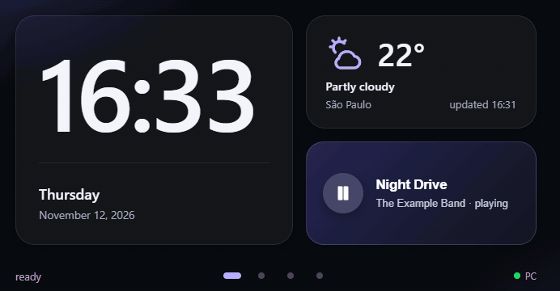
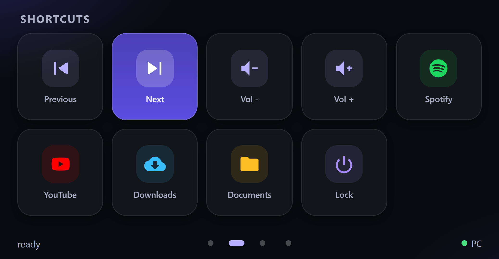
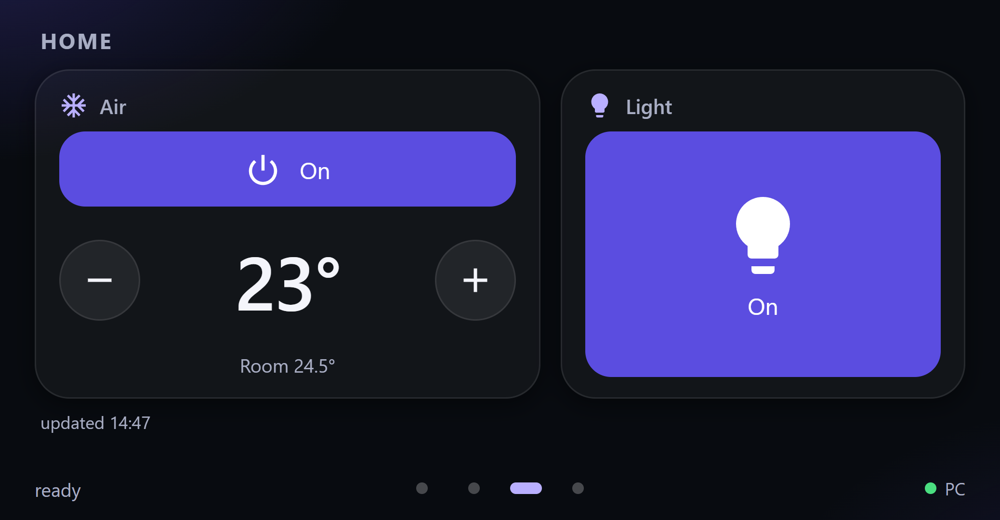
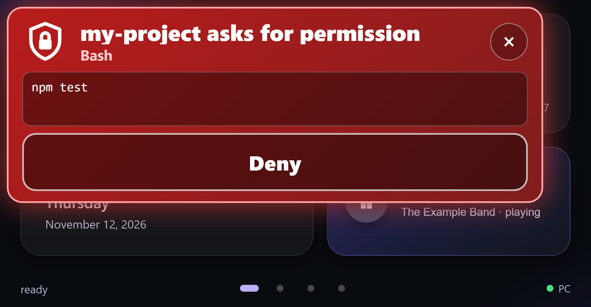

[English](README.md) | **Português (Brasil)**

# MCP Display Companion

**Transforme um celular Android velho num painel de parede para o seu agente de IA.**

Este é um painel pronto para o app [MCP Display](https://okapp.ai/app/mcp-display/pt) ([Google Play](https://play.google.com/store/apps/details?id=br.com.okds.mcpdisplay)). Ele roda no seu computador, põe a tela no celular e executa o que você toca: mídia, volume, atalhos, fotos.

[](https://github.com/PatrickCavalcanti/mcp-display-companion/actions/workflows/tests.yml)
[](LICENSE)


<p align="center">
  
</p>
<p align="center">
  
  
  
</p>

## O que você ganha

| Função | O que faz |
|---|---|
| Relógio e clima | Relógio grande e um cartão de clima (open-meteo, sem chave de API). |
| Mídia e volume | Play/pause, próxima, anterior, volume, e a faixa atual com a capa. Só no Windows. |
| Atalhos do PC | Botões que abrem uma pasta, um app, uma página da web, rodam um comando ou apertam uma tecla. Você os declara no `config.json`. |
| Apresentação de fotos | Uma página de fotos em tela cheia, de uma pasta sua, com transição suave. |
| Modo descanso | Depois de um tempo sem toque, a tela fica preta e com brilho mínimo. O primeiro toque acorda. |
| Painel de pé | Com o celular em pé, a mesma tela se reorganiza em coluna. |
| Página de casa | Ar-condicionado e luz de um cômodo, pelo [Home Assistant](https://www.home-assistant.io/). Desligada por padrão. |
| Aviso do Claude Code | Um aviso vermelho quando uma sessão do Claude Code espera uma permissão. Pelo painel você pode negar com um toque. |

## Começando

Já tem um agente de IA pareado com o app (o Claude Code, por exemplo)? Peça a ele para instalar este projeto. O app ensina o agente: ele baixa este repositório, configura e instala como serviço, com a sua aprovação. Os passos abaixo são o jeito manual.

Você precisa de:

- Python 3.11+ no computador.
- O app [MCP Display](https://play.google.com/store/apps/details?id=br.com.okds.mcpdisplay) num celular Android 7.0 ou mais novo. Ele é gratuito, com anúncios. O celular e o computador precisam estar na mesma rede.
- O endereço do painel e o token, os dois no app. Na primeira abertura o app inicia o servidor MCP em `http://<ip-do-celular>:7777/mcp`. Para ver o endereço: abra o menu do painel (arraste o canto superior direito para dentro e segure até a contagem 3-2-1 terminar) e toque em **Parear agente**. Ele mostra o endereço com um QR code e um botão de copiar. O token está na mesma tela, em **Outras formas → Mostrar token para o agente**.

```bash
git clone https://github.com/PatrickCavalcanti/mcp-display-companion.git
cd mcp-display-companion

python -m pip install -r requirements-windows.txt   # só Windows: mídia, capa, pastas
cp config.example.json config.json                  # depois edite panel.url (cmd do Windows: copy; o PowerShell aceita cp)

# o token fica fora do repositório, nunca no config.json
python -m mcp_display_companion --set-token SEU-TOKEN

python -m mcp_display_companion --check             # valida a configuração e mostra um resumo
python -m mcp_display_companion                     # roda o serviço neste terminal
```

Rodando, o celular mostra o painel: relógio, clima, o botão grande de play/pause. Toque nele e o serviço registra no log `touch: pc_midia_play_pause (ev #1) -> ok`.

Para continuar rodando depois de fechar o terminal, instale como serviço:

```powershell
# Windows: uma tarefa do Agendador de Tarefas que inicia no logon
powershell -ExecutionPolicy Bypass -File scripts\install-service.ps1
```

```bash
# macOS / Linux: agente launchd / unidade systemd --user
./scripts/install-service.sh
```

As fotos da página de apresentação são exemplos da pasta `slides/`. Ponha as suas ali, ou aponte `slides.folder` no `config.json` para uma pasta sua.

## Construído em cima

O painel é uma base. Duas coisas feitas sobre ele:

- **Página de casa.** Ligue `home` no `config.json` e o painel ganha uma página com um ar-condicionado (liga/desliga, temperatura) e uma luz. O celular fala direto com o Home Assistant, por uma conexão que você configura no app MCP Display, então os botões não passam pelo computador. Veja [`home` na configuração](docs/configuration.md#home--home-control-page-home-assistant).
- **Aviso de permissão do Claude Code.** Um hook avisa o painel quando uma sessão espera uma permissão. Negar é um toque. Aprovar pelo painel vem **desligado** por padrão (`alerts.allow_approve`); ligado, exige segurar o botão por 1,5 s. O hook se instala com dois comandos, como plugin do Claude Code: `claude plugin marketplace add PatrickCavalcanti/mcp-display-companion` e depois `claude plugin install mcp-display-alerts@mcp-display`. O plugin instala só o hook: o serviço (este repositório, versão 1.1 ou mais nova) precisa estar rodando, e no Windows é preciso Git Bash ou PowerShell 7. Veja [`alerts` na configuração](docs/configuration.md#alerts--claude-code-asking-for-permission).

## Como se compara

[WallPanel](https://github.com/thanksmister/wallpanel-android) e [Fully Kiosk Browser](https://www.fully-kiosk.com/) são apps Android para mostrar páginas da web em modo quiosque. O WallPanel se descreve como um "Android application for Web Based Dashboards and Home Automation Platforms" (aplicativo Android para painéis web e plataformas de automação residencial), controlado por MQTT ou HTTP, com leitura de sensores e recursos de câmera. O Fully Kiosk Browser se descreve como um app Android de quiosque, com modo quiosque, administração remota, API REST e integração MQTT.

Se você precisa de um navegador travado num painel, com sensores, câmera ou gestão de vários aparelhos, eles fazem isso bem e este projeto não os substitui. Este projeto é para quando um agente de IA, via MCP, desenha e atualiza a tela, e os toques voltam para ele como ações no seu computador.

## Perguntas frequentes

**Posso usar um celular Android velho como painel para o Claude Code?**
Pode. O celular roda o app MCP Display, este serviço roda no seu computador, e a página de aviso do Claude Code aparece quando uma sessão espera uma permissão. Qualquer agente com suporte a MCP também pode desenhar no painel pelo app. O hook se instala com `claude plugin marketplace add PatrickCavalcanti/mcp-display-companion` e `claude plugin install mcp-display-alerts@mcp-display`. O plugin instala só o hook: o serviço (este repositório, versão 1.1 ou mais nova) precisa estar rodando, e no Windows é preciso Git Bash ou PowerShell 7.

**O app é gratuito?**
É, com anúncios. Uma compra única remove os anúncios. Ele está no [Google Play](https://play.google.com/store/apps/details?id=br.com.okds.mcpdisplay).

**Funciona com o Home Assistant?**
Funciona, para um ar-condicionado e uma luz de um cômodo. Ligue `home` e configure uma conexão com o Home Assistant no app MCP Display. As entidades precisam estar expostas ao Assist no Home Assistant. A página avisa e escurece quando o Home Assistant não responde.

**Meu computador precisa ficar ligado?**
Para mídia, atalhos, apresentação e aviso, sim: o serviço roda nele, e o rodapé do painel mostra **PC offline** depois de 150 s sem sinal. A página do Home Assistant é a exceção: o celular chama o Home Assistant sozinho, então os botões dela funcionam com o computador desligado.

**Funciona no Linux ou no macOS?**
O serviço roda lá, e também pastas, URLs, apps e comandos. Os botões de mídia, volume e tecla são só do Windows: no Linux e no macOS eles respondem falha. A faixa tocando e a capa também são só do Windows. A suíte de testes roda no Linux e no Windows no CI, com as partes do sistema simuladas.

**O painel fica no meu idioma?**
Os textos do próprio painel vêm em inglês por padrão. Ponha `view.language` em `"pt-BR"` para português. Os rótulos dos botões vêm das suas `actions` e aparecem como você escreveu.

**É seguro aprovar permissões pelo celular?**
Aprovar vem desligado, então o painel só consegue negar. Se você ligar `alerts.allow_approve`, aprovar exige segurar por 1,5 s, mas qualquer pessoa que alcance o painel pode aprovar o que o Claude Code pede para rodar. Ligue só para um painel que mais ninguém alcança.

## Documentação

- [MCP Display](https://okapp.ai/app/mcp-display/pt): a página do app.
- [Referência de configuração](docs/configuration.md) (em inglês)
- [Tipos de ação](docs/actions.md) (em inglês)
- [Rodando como serviço, logs, atualização, limites](docs/service.md) (em inglês)
- [Notas para agentes de IA que instalam isto](docs/for-agents.md) (em inglês)
- [Changelog](CHANGELOG.md) e [Como contribuir](CONTRIBUTING.md)

## Desenvolvimento

```bash
python -m pip install pytest
python -m pytest -q          # sem rede, sem APIs do Windows: tudo com fakes
```

```
mcp_display_companion/
  __main__.py    CLI: rodar, --check, --print-view, --set-token
  config.py      configuração JSON + segredos, validação, expansão de caminho
  client.py      transporte MCP (JSON-RPC sobre HTTP, SSE subscribe, 404/429)
  events.py      decisão pura: qual evento vira ação
  actions.py     registro de ações; só os ids configurados rodam
  host.py        tudo que é do sistema (mídia e Explorer no Windows, genérico)
  live.py        clima e metadados de mídia, cada um no seu ritmo
  runtime.py     o laço: heartbeat, watchdog, cursor, publicar/atualizar, confirmar
  view.py        monta templates/painel.html a partir da configuração
  strings.py     os textos do painel, por idioma
  icons.py       símbolos SVG
templates/painel.html   a tela (CSS, relógio, gestos, aviso de PC offline)
service.py       supervisor: reinicia o serviço e registra por que ele caiu
scripts/         instaladores e o hook de aviso do Claude Code
tests/           pytest
```

## Licença

MIT. Veja [LICENSE](LICENSE).
